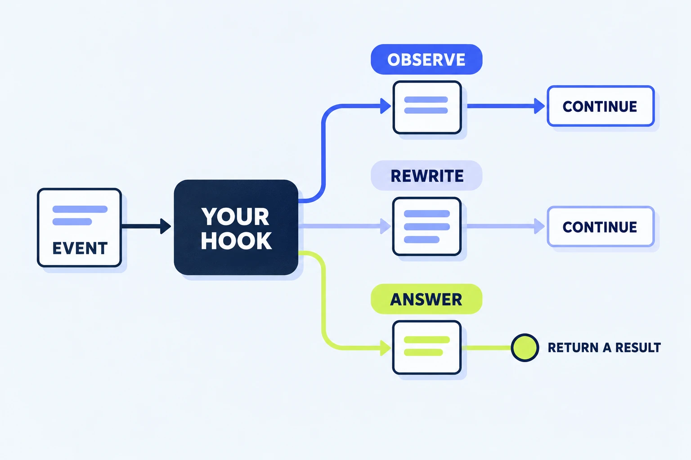

# Claude Mod Kitchen Sink

**Learn Claude customization by changing one working example at a time.**

A practical, MIT-licensed workshop for people who want to understand plugins and build their first Claude Code mod. Includes a Cowork workflow plugin, an interactive UI mod, and an [eight-lesson course](https://reachjalil.github.io/claude-mod-kitchen-sink/) with four illustrated explainers, exercises, checkpoints, and progress saved in your browser.

**[Start the course →](https://reachjalil.github.io/claude-mod-kitchen-sink/) · [Try the experiments](docs/experiments.md) · [Read the source](plugins/kitchen-sink/hooks/register.js) · [Official references](docs/sources.md)**

Independent community project. Not affiliated with or endorsed by Anthropic.

[](https://reachjalil.github.io/claude-mod-kitchen-sink/lessons/04-follow-an-event.html#playground)

*Follow the event through a hook, then [try all three choices in the browser explainer](https://reachjalil.github.io/claude-mod-kitchen-sink/lessons/04-follow-an-event.html#playground).*

## Follow the course

The [course homepage](https://reachjalil.github.io/claude-mod-kitchen-sink/) has eight individually linked lesson pages in three sections:

| Section | Lessons |
| --- | --- |
| Foundations | [Building blocks](https://reachjalil.github.io/claude-mod-kitchen-sink/lessons/01-building-blocks.html), [choose a surface](https://reachjalil.github.io/claude-mod-kitchen-sink/lessons/02-choose-your-surface.html) |
| Hands-on | [Cowork workflow](https://reachjalil.github.io/claude-mod-kitchen-sink/lessons/03-cowork-workflow.html), [events and hooks](https://reachjalil.github.io/claude-mod-kitchen-sink/lessons/04-follow-an-event.html), [UI and state](https://reachjalil.github.io/claude-mod-kitchen-sink/lessons/05-draw-and-redraw.html), [plugin anatomy](https://reachjalil.github.io/claude-mod-kitchen-sink/lessons/06-read-the-plugin.html) |
| Finish and share | [Your first change](https://reachjalil.github.io/claude-mod-kitchen-sink/lessons/07-make-a-change.html), [check and share](https://reachjalil.github.io/claude-mod-kitchen-sink/lessons/08-check-and-share.html) |

Every lesson has goals, an exercise, a short checkpoint, and previous/next navigation. Mark a lesson complete, undo the mark, or resume later. Only known lesson IDs and completion marks are saved in local browser storage; lessons stay open and no account is needed. The [original guide remains a quick reference](https://reachjalil.github.io/claude-mod-kitchen-sink/reference.html).

## Choose your starting point

| You want to… | Start here | What you will see |
| --- | --- | --- |
| Understand the idea before installing | [Event-and-hook lesson](https://reachjalil.github.io/claude-mod-kitchen-sink/lessons/04-follow-an-event.html#playground) | A labeled browser simulation of observing, rewriting and answering an event |
| Customize a workflow in Cowork | [Cowork plugin](#try-the-cowork-workflow) | Reusable commands that turn supplied notes into an experiment card |
| Add buttons, tabs and a pane | [Claude Code mod](#try-the-ui-mod) | An interactive lab inside a supported Claude Code surface |
| Build your own version | [First-change tutorial](docs/build-your-first-mod.md) | An explained change with an observable result |

**Cowork and the desktop Code tab are different surfaces.** The Cowork example adds workflow commands. The custom UI example targets Claude Code, including the desktop **Code tab**. This project does not claim that Cowork draws the mod’s pane. See the dated [compatibility notes](docs/compatibility.md).

## Try the Cowork workflow

**You need:** Claude with plugin upload available on your plan/account. No terminal, Node, Python or connected service is needed if you download the prebuilt ZIP.

1. [Download kitchen-cowork.zip](https://reachjalil.github.io/claude-mod-kitchen-sink/downloads/kitchen-cowork.zip) and keep it zipped.
2. In the Cowork / unified Claude desktop experience, open **Customize → Plugins** and use the custom upload option. UI labels and organization policy can vary.
3. Run `/kitchen-cowork:tour`.
4. Attach the [synthetic workshop notes](plugins/kitchen-cowork/examples/workshop-notes.md), then run `/kitchen-cowork:experiment`.

**Expect:** an experiment card with **Goal**, **Smallest change**, **Observable result**, and **Next question**. This is a model following a reusable prompt, so outputs can vary. It uses normal conversation-model usage.

**Change it:** edit the fields in [experiment.md](plugins/kitchen-cowork/commands/experiment.md), rebuild with `npm run package:cowork` from the repository root, re-upload `dist/kitchen-cowork.zip`, and compare. Building the ZIP requires Python 3.9+; the npm wrapper also requires Node.

## Try the UI mod

**You need:** Claude Code in a supported interactive surface. The documented terminal minimum is **2.1.287**; desktop Code minimum is **2.1.286**. Run `claude --version` in a terminal or `/status` inside the Code tab: the versions can differ. Newer API behavior can vary; use the generated declarations for your build.

### Terminal: the shortest development loop

Clone the repository, enter its root, and launch the mod:

```sh
git clone https://github.com/reachjalil/claude-mod-kitchen-sink.git
cd claude-mod-kitchen-sink
claude --plugin-dir ./plugins/kitchen-sink
```

At the **Claude prompt**, enter:

```text
/kitchen
```

**Expect:** a pane with **recipes**, **events**, and **notes** tabs. Click the counter; the number changes without a model request. Use a draft button with an empty prompt box, review the text, then send it yourself. Run `/kitchen-status` to inspect counters and reported render surfaces.

No `npm install` or build step is needed to load the mod. Edit [register.js](plugins/kitchen-sink/hooks/register.js) while the `--plugin-dir` session is open; Claude watches that directory and reloads the module. Counters reset on reload; saved notes remain.

### Desktop Code tab: install the local marketplace

First clone or download this repository. In a **local Code session in Claude Desktop**, run the following. Replace the example absolute path with your clone’s path:

```text
/plugin marketplace add /absolute/path/to/claude-mod-kitchen-sink
/plugin install kitchen-sink@claude-mod-kitchen-sink
/reload-plugins
/kitchen
```

Use the direct terminal directory for active editing; an installed marketplace copy can differ from your working tree. The mod passes native desktop element-contract tests. Final layout and installation in the desktop app still need the [manual acceptance pass](docs/experiments.md#desktop-acceptance-checklist) on your build.

## What does each recipe teach?

| Recipe | Try it | Why it matters |
| --- | --- | --- |
| Pane, tabs and button | `/kitchen`, then click the counter | Interactive UI can update without asking the model |
| Draft a prompt | Press a draft button with empty input | Fill a draft while the user controls sending; existing text is preserved |
| Rewrite one prompt | Send `[ks:brief] Explain panes` | An explicit prefix opts in to a changed event |
| Register a tool | Ask to mix 2 imaginary portions | A mod can provide a tool without a separate server process |
| Guard a tool | Read the 1–3 portion validation | Answer or deny only the plugin’s own imaginary operation |
| Observe events | Use a tool and open Events | Count calls without storing tool contents |
| Compose UI | Inspect the band above the prompt | Keep downstream drawings from other mods |
| Restyle a detail | Watch the spinner during activity | Extend the normal rendering instead of replacing the whole view |
| Save a note | Save, reopen, delete | Learn local persistence and its cross-session limits |
| Provide a fallback | `/kitchen-status` | A text command is useful when no UI renderer is available |

Read the [annotated walkthrough](docs/explainer.md) for `$`, `e`, `next`, the event chain, and state lifetimes.

## Check a change

For the complete local check set: **Node.js 20+**, **Python 3.9+**, and a recent **Claude Code**. No dependency installation is required.

```sh
npm test                # Behavioral regression tests; includes packaging checks
npm run validate       # Real Claude static validator, both plugins + marketplace
npm run test:native    # Real mod-host tests, terminal + desktop element contracts
npm run site:build     # Builds the guide, current source excerpts, and download ZIP
npm run site:check     # Checks guide links, snippet freshness, and download members
```

Native validation and host tests were run with Claude Code **2.1.301**. Browser testing of the guide is separate from desktop-mod testing. [See the validation record](docs/validation.md) for exact scope and remaining gaps.

## Project map

```text
plugins/kitchen-sink/     Real mod: manifest, hooks module, native host test
plugins/kitchen-cowork/   Workflow commands and synthetic sample notes
site/                    Course content, reference HTML, CSS, browser-only JS
scripts/                 Course rendering, validation, packaging, site build/check
tests/                  Behavioral and distribution tests
docs/                   Explainers, tutorials, troubleshooting, references
```

The mod uses no network, process, automatic model, or session-messaging APIs. Only an explicitly saved scratch note persists in the plugin’s local store. Mods in general run with your machine access; inspect code before loading. [Security and data](SECURITY.md).

## Get unstuck, extend it, share it

- [Troubleshooting](docs/troubleshooting.md): missing commands, absent UI, stale copies, notes and removal.
- [First-change tutorial](docs/build-your-first-mod.md): a small code change, expected behavior and an extension exercise.
- [Sources](docs/sources.md): official documentation, public types and upstream examples.
- [Contributing](CONTRIBUTING.md): how to add one clear recipe and describe its limitations.
- [GitHub Pages publishing](docs/publishing.md): reproduce or host the guide from your fork.

Both plugin bundles and the guide use the [MIT license](LICENSE). The self-hosted Manrope font uses the SIL Open Font License; see [asset notices](THIRD_PARTY_NOTICES.md). The [event-flow brief](docs/illustration-brief.md) and [course illustration briefs](docs/course-illustration-briefs.md) include reusable prompts and text explanations. Fork it, teach from it, or use a recipe as a starting point. Keep demonstrations synthetic and record the surface/version you actually checked.
