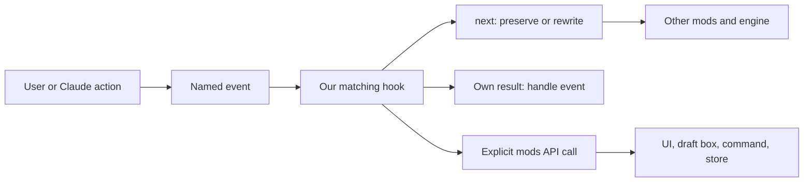

# How the pieces fit

`register(on)` owns session-local variables and registers literal event names. Hooks receive `$` (the host API), `e` (frozen event data) and `next` (the downstream handler). We copy events when rewriting. We forward unrelated events and keep other mods' AbovePrompt content in the tree.

The generic tool hook observes all calls and forwards them. A filtered handler answers only `mcp__kitchen-sink__mix`; invalid portions return a denial. It is a teaching guard, not a shell security policy. Its error handler also denies that imaginary operation.

The model sees a registered demo tool and chooses whether to call it. UI draft buttons only fill the prompt box; the user sends the draft. The brief prefix transforms just that prompt. It does not modify the system prompt.

Tab, counters and a bounded 12-label event buffer live in memory and reset on module reload. Only the explicit scratch note save goes to the plugin store. It is limited to 500 characters, shared across local sessions of this plugin, and uses last-save-wins semantics. Existing sessions can show an older in-memory note until reload. There is no polling or concurrent merge algorithm.

Cowork's plugin is independent: its Markdown commands expand into instructions for the conversation model. Bundled notes are input data, not privileged instructions. The sample can be attached explicitly when the session cannot access plugin files.

The native validator's inventory is the most useful way to audit which host APIs this code calls. Generated type declarations from your installed build take precedence over online examples. See the official [authoring loop](https://code.claude.com/docs/en/plugins/mods/create).
